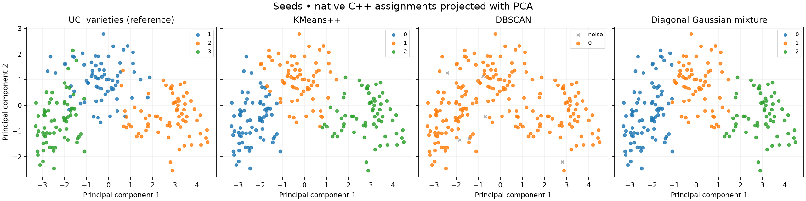

# C++ ML Portfolio

[](https://github.com/izaakdias/cpp-ml-portfolio/actions/workflows/build.yml)

Ten original machine learning and systems engineering projects inspired by **Hands-On Machine Learning with C++, Second Edition**, by Kirill Kolodiazhnyi. Original implementations, real public datasets, persisted models, and reproducible commands. The book and its examples are not redistributed.

The core libraries and desktop applications use C++20. Python prepares datasets and exports models. The Android app uses Kotlin/CameraX, ONNX Runtime, and custom C++ preprocessing and postprocessing through JNI.

## Projects

| # | Project | Model and deliverables | Guide |
|---|---|---|---|
| 1 | ONNX inference engine | Library, CLI, HTTP, dynamic batches, latency percentiles | [Run](docs/projects.md#1-onnx-inference-engine) |
| 2 | Industrial vision inspector | ResNet18 + embedding distance; images, video, and camera | [Run](docs/projects.md#2-industrial-vision-inspector) |
| 3 | Native sentiment service | DistilBERT SST-2 + native Unicode WordPiece; CLI and HTTP | [Run](docs/projects.md#3-native-sentiment-service) |
| 4 | Streaming anomaly monitor | Isolation Forest, windows, per-device state, and checkpoints | [Run](docs/projects.md#4-streaming-anomaly-monitor) |
| 5 | Native recommender | Biased matrix factorization, ranking, and model recovery | [Run](docs/projects.md#5-native-recommender) |
| 6 | Clustering explorer | KMeans++, DBSCAN, diagonal GMM, and PCA | [Run](docs/projects.md#6-clustering-explorer) |
| 7 | Tabular ML library | Ridge via QR, logistic regression, and kNN; validation-based selection | [Run](docs/projects.md#7-tabular-ml-library) |
| 8 | Native CNN trainer | LeNet/MNIST trained in C++ with LibTorch; checkpoint and ONNX | [Run](docs/projects.md#8-native-cnn-trainer) |
| 9 | Native experiment tracker | MLflow REST client integrated with regression training | [Run](docs/projects.md#9-native-experiment-tracker) |
| 10 | Android offline detector | SSD MobileNet v1, CameraX, C++ YUV conversion/rotation/NMS | [Run](projects/android-detector/README.md) |

## Measured results

Results from a local CPU run on macOS arm64. Split and selection policies are documented in the [methodology](docs/validation.md). These measurements describe the datasets used; they do not establish performance in a factory or on an arbitrary phone.

| Application | Result |
|---|---|
| LeNet / MNIST | **98.52%** accuracy on 10,000 test images |
| Inspection / MVTec AD bottle | ROC-AUC **0.9833**, F1 **0.9421**, 83 test images |
| Isolation Forest / NAB | ROC-AUC **0.9655**, recall **0.9644**, precision **0.6459** |
| Regression / Auto MPG | MAE **2.7466 mpg**; training-mean baseline **6.7666 mpg** |
| Logistic regression / binary Wine | F1 **0.8696**; reference kNN **1.0** on just 38 test samples |
| KMeans / Seeds | Adjusted Rand Index **0.7733** |
| Recommendation / MovieLens 100k | RMSE **1.0092**; full-catalog ranking and limitations documented in the report |

[JSON results](docs/results/) · [Architecture and trade-offs](docs/architecture.md) · [Models and evaluation](docs/validation.md) · [Data/model licenses](docs/data-and-licenses.md)



Figure source: UCI Seeds data (CC BY 4.0), with projection and assignments computed by the C++ application.

## Getting started

Download the Android demonstration APK from the [latest release](https://github.com/izaakdias/cpp-ml-portfolio/releases/latest). See the [Android guide](projects/android-detector/README.md) for setup and device-evaluation limitations.

Requirements: CMake ≥3.25, Ninja, a C++20 compiler, OpenSSL, and [uv](https://docs.astral.sh/uv/). Prebuilt runtime platforms: macOS Apple Silicon, Linux x64, and Linux arm64. Native training uses the LibTorch installation supplied by the PyTorch wheel.

```bash
# macOS: install these if needed
brew install cmake ninja openssl@3
# Linux: apt install cmake ninja-build libssl-dev

uv sync --frozen
uv run python tools/bootstrap.py
uv run python tools/assets.py core
cmake --preset release -DPORTFOLIO_VISION=OFF -DPORTFOLIO_TORCH=OFF
cmake --build --preset release

build/ml_baselines
build/ml_baselines --task regression
build/anomaly_monitor
build/recommender
build/clustering_explorer
uv run python tools/export_tabular.py
build/inference_engine --mode infer
```

Downloads are verified with SHA-256. Datasets, weights, and large artifacts stay outside Git. `--record` is reserved for reviewed manifest updates; normal reproduction uses the published hashes.

### Build all nine desktop executables

```bash
uv run python tools/build_opencv.py
cmake --preset release -DPORTFOLIO_VISION=ON -DPORTFOLIO_TORCH=ON \
  -DOpenCV_DIR="$PWD/.cache/opencv/lib/cmake/opencv4" \
  -DCMAKE_PREFIX_PATH="$(uv run python -c 'import torch; print(torch.utils.cmake_prefix_path)')"
cmake --build --preset release
```

On Linux, the package manager's `libopencv-dev` also works, replacing `build_opencv.py` and the explicit `OpenCV_DIR` setting.

### Local services

```bash
build/inference_engine --mode serve --port 8080
# In another terminal:
curl http://127.0.0.1:8080/health
curl -H 'Content-Type: application/json' --data-binary @models/linear-input.json \
  http://127.0.0.1:8080/infer

uv run python tools/assets.py bert
build/sentiment_service --mode serve --port 8081
curl -H 'Content-Type: application/json' -d '{"text":"This movie was excellent."}' \
  http://127.0.0.1:8081/sentiment
```

Services bind to loopback by default. An exposed deployment needs authentication, rate limits, and TLS at its gateway. DistilBERT SST-2 evaluates **English**; this model does not provide Portuguese sentiment classification.

## Repository structure

```text
include/portfolio/   public contracts
src/                algorithms, persistence, tokenization, and adapters
apps/               use-case composition and CLIs
tools/              data preparation, export, and dependency setup
tests/              C++ contract, algorithm, and integration tests
projects/           Android application with Kotlin and JNI
docs/               decisions, commands, metrics, and licenses
```

CI builds the Linux executables, runs the existing suite in Release and ASan/UBSan, and builds the Android APK. Physical camera and device execution require hardware; device FPS, battery use, and mobile latency have not been measured.

Original code is licensed under [MIT](LICENSE). The Gradle wrapper and external libraries retain their own licenses; datasets and models have separate terms.
