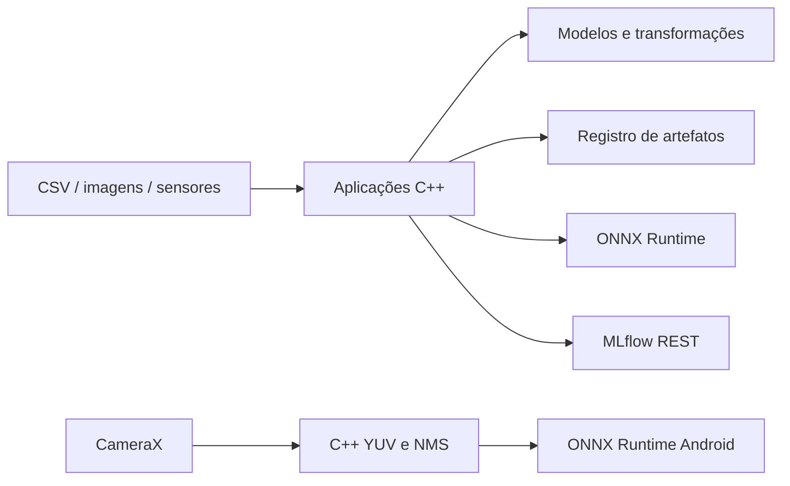

# Arquitetura e decisões

## Estrutura comum

Bibliotecas C++ e aplicações executáveis em um monorepo. Cada algoritmo tem contrato explícito, parâmetros validados e dependências limitadas. As aplicações decidem políticas de divisão/seleção; as classes de modelo realizam operações matemáticas. HTTP, MLflow e arquivos são adaptadores. O domínio não depende de Android, câmera ou Python.

Não há microserviços internos nem um framework próprio de plugins: nove binários usam componentes pequenos. Isso reduz configuração e facilita depuração. O custo é recompilar o consumidor quando o contrato da biblioteca muda; escalar equipes e serviços independentemente exigiria um processo de release mais formal.

## Decisões por projeto

| Projeto | Arquitetura escolhida e benefício | Alternativa e custo |
|---|---|---|
| ONNX engine | Uma sessão persistente, buffers de entrada com ownership e saídas copiadas; CLI/HTTP usam a mesma API. Evita dangling pointers e recarga de pesos por requisição. | SDK específico de cada framework pode expor mais operações, mas acopla runtime e pesos. Zero-copy reduz cópias e exige controle mais difícil de vida útil. |
| Visão | OpenCV cuida de captura/pré-processamento; ONNX executa encoder e score juntos. Configuração vincula limiar ao SHA do modelo. | Treinar uma CNN supervisionada exige defeitos representativos. PatchCore/PaDiM detectam regiões e ganham expressividade, com memória, ajuste e implementação maiores. |
| Sentimento | WordPiece próprio Unicode + DistilBERT já exportado; frontend HTTP fino. Consistência de tokenização é mensurada contra o tokenizer original. | Transformer treinado do zero demanda muitos dados e compute. Tokenizer externo reduz manutenção, mas acrescenta outra dependência nativa. DistilBERT preserva custo menor que BERT base. |
| Anomalias | Isolation Forest sobre mean/std/last/range por sensor; janelas isoladas por dispositivo. Checkpoints versionados mantêm a referência ao modelo de treinamento. | Autoencoder/TCN aprendem relações temporais mais ricas, com maior custo e necessidade de dados. A janela estatística perde ordem interna e padrões de frequência. |
| Recomendação | Fatoração explícita + vieses, vetores contíguos, busca exaustiva e snapshots recuperáveis. Boa base auditável para ratings. | ALS implícito/BPR otimizam outro problema; ANN ajuda catálogos grandes, acrescentando índice e recall aproximado. Conteúdo é necessário para cold start. |
| Clustering | Algoritmos separados e projeção PCA; rótulo real é usado somente no ARI da avaliação. Permite observar falhas de cada hipótese. | GMM de covariância completa modela correlações, mas exige regularização e mais dados. DBSCAN com índice espacial reduz custo; HDBSCAN evita um epsilon global. |
| Tabular | Transformação ajustada somente no treino, seleção em validação e QR com regularização. Baselines mostram valor do modelo. | Boosting captura não linearidades e interações, com outra dependência e menor transparência. Normal equations são mais simples, mas agravam condicionamento numérico. |
| CNN | LibTorch em C++, Adam e melhor checkpoint por validação. Parâmetros nomeados são exportados para reconstrução/ONNX e comparação numérica. | Python é mais conveniente para experimentação. O frontend C++ demonstra ownership, treinamento e implantação na mesma linguagem; compila mais lentamente. LeNet é adequada ao MNIST, limitada em imagens complexas. |
| MLflow | Cliente REST síncrono com timeouts; treinamento falha explicitamente se o registro falhar. Logs remotos e pesos locais têm identificadores vinculados. | Um cliente SDK completo suporta uploads/retries/autologging; aumenta tamanho e acoplamento. Uma fila durável permite tolerar indisponibilidade, mas requer estado/reconciliação. |
| Android | CameraX `KEEP_ONLY_LATEST`, executor único, sessão ORT persistente, JNI para pixels/rotação/NMS, overlay FIT_CENTER. Não acumula frames antigos. | Inferência remota depende de rede e transmite imagens. GPU/NNAPI pode reduzir tempo, mas depende de operadores e aparelhos; CPU é a configuração inicial comparável. |

## Persistência

`save_artifact` grava um diretório temporário, calcula SHA de modelo e metadados, renomeia a versão completa e publica `latest.json` por rename no mesmo filesystem. Leitura verifica manifestos. Uma promoção explícita permite rollback. Escritas concorrentes têm versões distintas; a última promoção vence.

É um registro **local**: não implementa fsync para durabilidade contra perda de energia, transação entre filesystems, armazenamento remoto, assinatura/autenticidade ou garbage collection. SHA detecta corrupção acidental; não autentica um produtor. A aplicação de streaming persiste ao fim de cada arquivo/batch. Se interrompida antes disso, o batch deve ser reprocessado e os consumidores devem deduplicar eventos por dispositivo/timestamp/modelo.

## Limites operacionais

- DBSCAN e silhouette/exploração trabalham em memória; DBSCAN é O(n²). Ranking de recomendações percorre o catálogo inteiro.
- Servidores têm limite de payload e pool limitado. A fila de trabalho é limitada; sobrecarga precisa de controle adicional no gateway.
- Há exceções explícitas para shape, dtype, valores não finitos, nomes de tensor e entradas incompatíveis.
- Predição de usuário desconhecido é rejeitada; item desconhecido usa média + viés do usuário. Não existe personalização para cold start.
- O estado de streaming suporta até 1.024 dispositivos; timestamps precisam aumentar por dispositivo. O aviso de distribuição usa distância padronizada à referência de treino, sem promessa de detector estatístico formal de drift.
- CLI e servidor aceitam modelos locais de confiança. O código não executa modelos arbitrários fornecidos por usuários externos.
