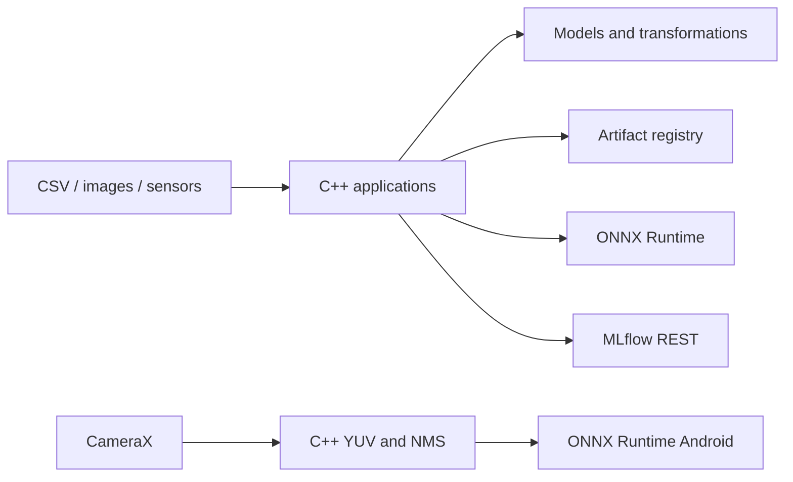

# Architecture and decisions

## Shared structure

C++ libraries and executable applications share a monorepo. Each algorithm has an explicit contract, validated parameters, and limited dependencies. Applications choose splitting and selection policies; model classes perform mathematical operations. HTTP, MLflow, and files are adapters. The domain does not depend on Android, cameras, or Python.

Nine binaries reuse small components in a single repository. This reduces configuration and simplifies debugging. Consumers must be recompiled when library contracts change; independent team and service scaling would require a more formal release process.

## Decisions by project

| Project | Chosen architecture and benefit | Alternative and cost |
|---|---|---|
| ONNX engine | A persistent session, owned input buffers, and copied outputs; CLI/HTTP share the same API. Prevents dangling pointers and per-request weight reloads. | Framework-specific SDKs may expose more operations but couple the runtime to model formats. Zero-copy reduces copying and requires stricter lifetime management. |
| Vision | OpenCV handles capture/preprocessing; ONNX executes the encoder and scorer together. Configuration binds the threshold to the model SHA. | Supervised CNN training requires representative defects. PatchCore/PaDiM can localize anomalies, with greater memory, tuning, and implementation costs. |
| Sentiment | Custom Unicode WordPiece + exported DistilBERT behind a small HTTP frontend. Tokenization consistency is measured against the original tokenizer. | Training a transformer from scratch requires substantial data and compute. An external tokenizer reduces maintenance but adds a native dependency. DistilBERT costs less to run than BERT base. |
| Anomalies | Isolation Forest over mean/std/last/range per sensor, with isolated per-device windows. Versioned checkpoints retain the training model reference. | Autoencoders/TCNs learn richer temporal relationships at greater data and compute cost. Statistical windows lose internal ordering and frequency patterns. |
| Recommendation | Explicit matrix factorization + biases, contiguous vectors, exhaustive scoring, and recoverable snapshots. An auditable baseline for ratings. | Implicit ALS/BPR optimize different objectives; ANN helps large catalogs but adds an index and approximate recall. Content features are needed for cold start. |
| Clustering | Separate algorithms and PCA projection; ground-truth labels are used only for evaluation ARI. Makes each method's assumptions and failures visible. | Full-covariance GMMs model correlations but need more data and regularization. Spatial indexing reduces DBSCAN cost; HDBSCAN avoids a single global epsilon. |
| Tabular | Transformations fitted only on training data, validation-based selection, and regularized QR. Baselines quantify the model's contribution. | Boosting captures nonlinearities and interactions, with another dependency and lower transparency. Normal equations are simpler but worsen numerical conditioning. |
| CNN | C++ LibTorch, Adam, and the best validation checkpoint. Named parameters are exported for reconstruction/ONNX and numerical comparison. | Python is more convenient for experimentation. The C++ frontend demonstrates ownership, training, and deployment in one language, with slower compilation. LeNet suits MNIST but is limited on complex imagery. |
| MLflow | Synchronous REST client with timeouts; training fails explicitly if tracking fails. Remote logs and local weights have linked identifiers. | A complete SDK supports uploads/retries/autologging but increases size and coupling. A durable queue tolerates downtime and requires state and reconciliation. |
| Android | CameraX `KEEP_ONLY_LATEST`, one executor, a persistent ORT session, JNI pixels/rotation/NMS, and a FIT_CENTER overlay. Avoids accumulating stale frames. | Remote inference depends on a network and transmits images. GPU/NNAPI may reduce latency but depends on operators and devices; CPU provides the initial comparison baseline. |

## Persistence

`save_artifact` writes a temporary directory, computes model and metadata SHA checksums, renames the completed version, and publishes `latest.json` by rename on the same filesystem. Reads verify manifests. Explicit promotion supports rollback. Concurrent writes produce distinct versions; the last promotion wins.

This is a **local** registry: it does not implement fsync for power-loss durability, cross-filesystem transactions, remote storage, signatures/authenticity, or garbage collection. SHA detects accidental corruption; it does not authenticate a producer. The streaming application persists at the end of each file/batch. If interrupted earlier, the batch must be replayed and consumers must deduplicate events by device/timestamp/model.

## Operational limits

- Clustering exploration runs in memory; DBSCAN is O(n²). Recommendation ranking scans the entire catalog.
- Servers enforce payload limits and bounded worker pools/queues. Overload needs additional control at the deployment gateway.
- Explicit exceptions cover shape, dtype, nonfinite values, tensor names, and incompatible inputs.
- Predictions for unknown users are rejected; unknown items use the mean + user bias. Cold-start personalization is not implemented.
- Streaming state supports up to 1,024 devices; timestamps must increase per device. The distribution warning uses standardized distance from the training reference, without claiming a formal statistical drift detector.
- The CLI and server load trusted local models. Arbitrary models supplied by external users are outside the supported deployment contract.
